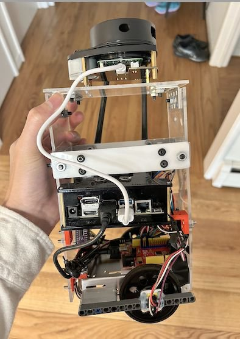
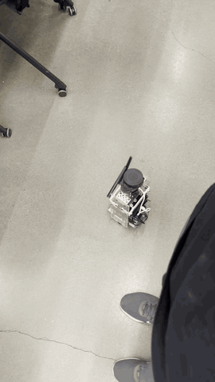
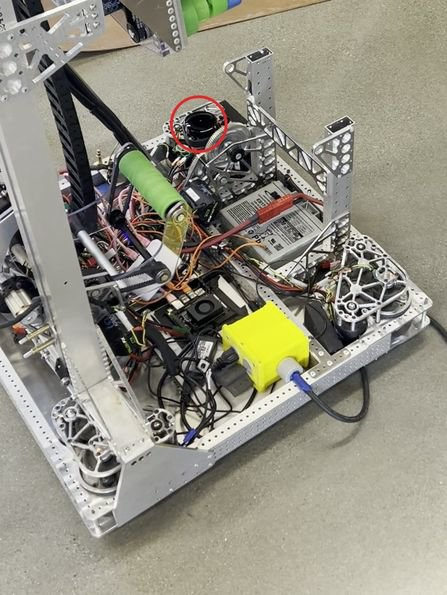
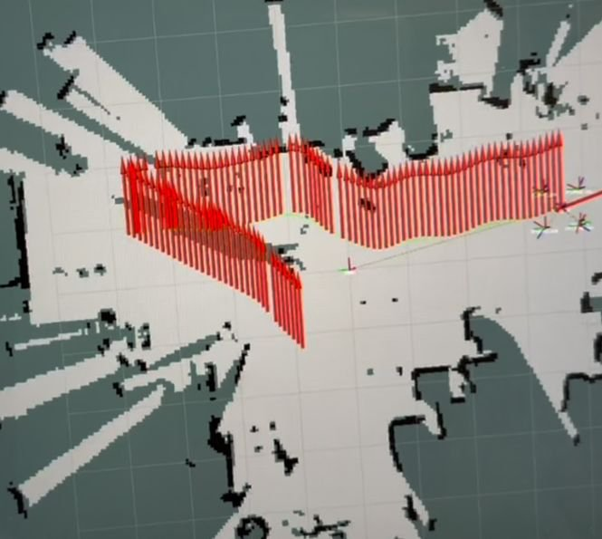
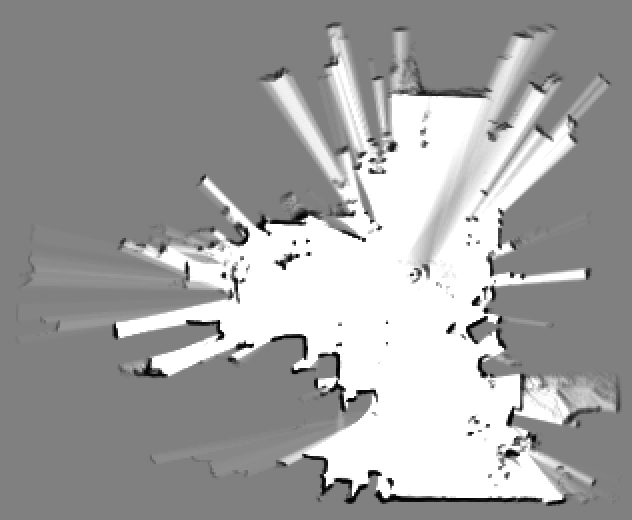
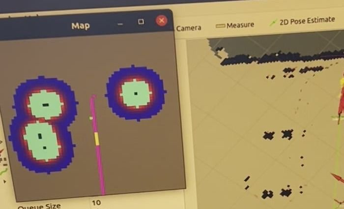
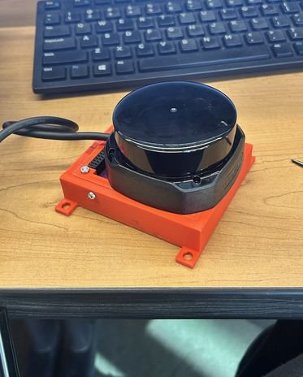

# ROS SLAM and Navigation

My own project (not a class assignment), 2024–2025: make a robot map a room, find
itself on the map, and drive to a goal I pick. I first built a small test robot on
a second-hand Boe-Bot chassis, then moved the same navigation setup to my FRC
team's (Team 114) swerve robot with a Jetson Orin Nano. This is the ROS 1 (Noetic)
code from the Jetson, for portfolio pages 1a–1f.



## Demo



Jan 6, 2025, 2x speed: the test robot drives itself toward a goal I set on the map.

- Video: the "Navigation" chapter of the portfolio video submitted with my MIT
  Maker Portfolio. It shows the Jan 6 run and the FRC robot moving toward a goal
  set in RViz.
- No robot needed: `demo_no_hardware.launch` (below) loads a school map I made
  and plans a route to any goal you click.

| | |
|---|---|
| <br>Feb 12, 2025: navigation test on the FRC robot (lidar circled) | <br>Dec 12, 2025: position and heading from wheel odometry (red) |
| <br>A school room mapped with Cartographer on the FRC robot (`map_school_4`) | <br>Jan 2025: local planner in RViz; obstacle clearance (rings), route (pink) |

## How it works

```
 lidar scan ──► lidar_loc ──────────────► where am I on the saved map?
 wheel encoders (+ IMU) ──► odometry ───┘          │
                                                    ▼
 saved map ──► costmap ──► global_planner ──► route ──► my_planner ──► velocity command
                                                                            │
          test robot: Arduino turns it into servo pulses ◄──────────────────┤
          FRC robot:  sent to the roboRIO, which drives the swerve modules ◄┘
```

1. Mapping: Cartographer (FRC robot) or hector_mapping (test robot) builds a 2D map from the lidar.
2. Localization: AMCL kept jumping, so I switched to `lidar_loc`, which matches each scan to the saved map.
3. Planning: `move_base` with `global_planner` finds a route; `my_planner` (open source) follows it.
4. Driving: the test robot sends wheel commands to an Arduino over USB serial; the FRC robot sends them to the roboRIO over the robot's network.

## Repository layout

```
src/my_navigation/      my package: nodes, launch files, configs, maps
  src/                  odometry, encoder, motor/PWM, calibration and roboRIO bridge nodes (Python)
  launch/               navigation.launch (test robot), new_navigation.launch and
                        odom_navigation.launch (FRC robot), demo_no_hardware.launch
  maps/                 four school maps (PGM + YAML) and Cartographer .pbstream files
  urdf/robot.urdf       test-robot model
src/drivebase_urdf/     FRC robot model: joint frames I added to the team chassis CAD
                        (the team's mesh files are not included)
src/my_behavior_tree/   experiment: a BehaviorTree.CPP sequence that sends goals to move_base
src/my_planner/         third-party local planner, GPL-3.0 (see its NOTICE.md)
deps.rosinstall         other open-source packages the robot launch files need
docs/images/            pictures for this README
```

Main files to read: `src/my_navigation/src/diffdrive_odom_publisher.py` (wheel
odometry), `joint_states_publisher.py` (AS5600 encoders through the I2C
multiplexer), `calibration_node.py` (servo PWM calibration), `odom_receive_nt.py`
and `cmd_vel_sent_nt.py` (FRC robot bridge), `launch/new_navigation.launch`.

## Build and run

Tested on Nov 1, 2026 in the `osrf/ros:noetic-desktop` Docker image (Ubuntu 20.04, ROS Noetic).

```bash
sudo apt install ros-noetic-navigation ros-noetic-behaviortree-cpp-v3 \
                 ros-noetic-ros-control libyaml-cpp-dev
mkdir -p ~/catkin_ws && cd ~/catkin_ws
git clone https://github.com/OAK-WJR/ros-slam-navigation.git repo && cp -r repo/src src
catkin_make
source devel/setup.bash
```

No-hardware demo (map + planner, the robot stays still):

```bash
roslaunch my_navigation demo_no_hardware.launch
# In RViz, click "2D Nav Goal" on the map. move_base plans a route
# (/move_base/GlobalPlanner/plan) and my_planner publishes /cmd_vel.
# Headless check from another terminal:
rostopic pub -1 /move_base_simple/goal geometry_msgs/PoseStamped \
  '{header: {frame_id: map}, pose: {position: {x: -2.5, y: 1.0}, orientation: {w: 1.0}}}'
rostopic echo -n1 /cmd_vel
```

In the Docker test this produced a 110-point route and velocity commands.

On the real robots (not re-tested for this snapshot; needs the hardware):

```bash
sudo apt install python3-wstool
cd ~/catkin_ws/src && wstool init . ../repo/deps.rosinstall && wstool update
# wpb_home: run its wpb_home_bringup/scripts/install_for_noetic.sh first
cd ~/catkin_ws && catkin_make
roslaunch my_navigation robot_control.launch       # test robot: encoders, Arduino PWM
roslaunch my_navigation navigation.launch          # test robot: map, lidar_loc, move_base, RViz
roslaunch my_navigation new_navigation.launch      # FRC robot: S2 lidar, roboRIO bridge, move_base
```

Hardware:
- Test robot: Boe-Bot chassis with two servos driving the wheels, Jetson Nano, Arduino
  Uno-compatible board, RPLidar A1M8, MPU-6050 IMU, two AS5600 magnetic encoders
  on a PCA9548A I2C multiplexer.
- FRC robot: Team 114's swerve robot, Jetson Orin Nano, RPLidar S2 in my printed
  mount, navX2 IMU. The roboRIO runs the team's robot code, which is not in this
  repository.



Jan 26, 2025: the RPLidar S2 in my printed mount.

Some paths are still the ones on the Jetson: `robot_info.yaml` is read from
`/home/jetson/catkin_ws/...`, and the behavior tree loads
`/root/catkin_ws/src/my_behavior_tree/config/tree8.xml`.

## Results and limits

- Jan 6, 2025: the test robot drove to a goal I picked on the map. During debugging
  the next day I sent ten goals; the software reported arrival at four.
- AMCL's position estimate jumped. Two causes were the left and right encoders
  being swapped and the lidar's direction being wrong in ROS. After fixing both it
  was still unreliable, so I switched to `lidar_loc`.
- On the FRC robot, a 3D lidar (Velodyne VLP-32C) with LIO-SAM and FAST-LIO gave
  distorted maps, so I used a 2D RPLidar S2 and Cartographer. Cartographer
  crashed with IMU input, so the final maps use lidar and wheel odometry only.
- March 2025: the FRC robot moved toward a goal set in RViz, but navigation stayed
  unreliable. With the lidar offline, it could not correct its position against
  the map.
- The behavior tree is an unfinished experiment for an FRC autonomous routine; it is not part of the portfolio pages.
- This is a snapshot, not a polished package: some launch and config files are
  from earlier attempts.
- Most code comments and log messages were written in Chinese at the time and translated into English in November 2026.

## Credits

What I did: chose the methods and the switch from AMCL to `lidar_loc`, built the
test robot, found the swapped encoders and the lidar direction, designed and
printed the lidar/IMU mount, added the joint frames to the team's chassis CAD,
chose which planner changes to make, and ran and tuned every test.

Code written by AI tools:
- Cursor wrote most of the ROS 1 motor-node porting, launch edits and TF debugging
  in Jan 2025, and much of the Orin-side ROS code in Feb and Dec 2025, including
  the planner changes I selected.
- A chat AI debugged from photos of my screen in Jan 2025, and drafted the
  odometry node (I corrected its heading sign and wheel order) and the roboRIO
  bridge code.
- Claude Code (Nov 2026) prepared this repository: it picked the files,
  translated the Chinese comments and log messages into English, wrote
  `demo_no_hardware.launch`, `deps.rosinstall`, this README and the GIF,
  and made three small build fixes (relative map paths in the map YAML files,
  the yaml-cpp lookup in `my_behavior_tree/CMakeLists.txt`, and dropping an old
  planner class from the `my_planner` build).

Open-source software and other people's work:
- ROS 1 Noetic, `move_base`, `global_planner`, `map_server`, AMCL, hector_mapping,
  Cartographer, BehaviorTree.CPP.
- `lidar_loc` from 6-robot/jie_ware (GPL-2.0), with two TF settings changed;
  costmap settings from 6-robot/wpb_home (GPL-2.0); `my_planner` from
  6-robot/wpr_simulation (GPL-3.0, see `src/my_planner/NOTICE.md`);
  `rplidar_ros` from Slamtec (BSD-2-Clause).
- FRC Team 114: the robot, its chassis CAD and its drive code. The chassis model
  was exported to URDF with SW2URDF; the team's mesh files are left out.

This repository keeps the real git history that exists: my first robot model
(Dec 2024) and the Jetson workspace commit (Jan 2026). Most of the work happened
directly on the Jetson, outside git, so the history is short. Logs, large maps
and the team's mesh files were removed from every commit.

## License

MIT for my own code and documents (see `LICENSE`). `src/my_planner/` is third-party code under GPL-3.0 and stays under GPL-3.0 (`src/my_planner/LICENSE`, `src/my_planner/NOTICE.md`).
